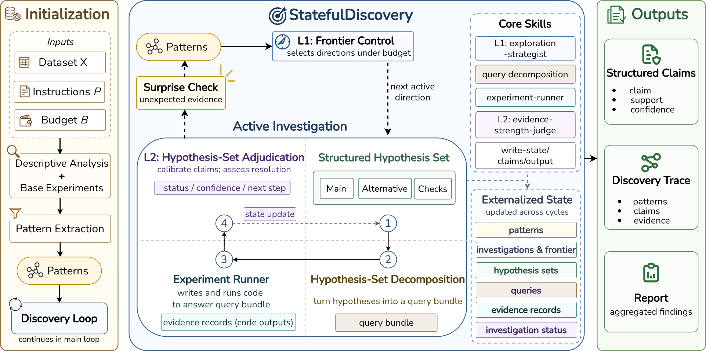
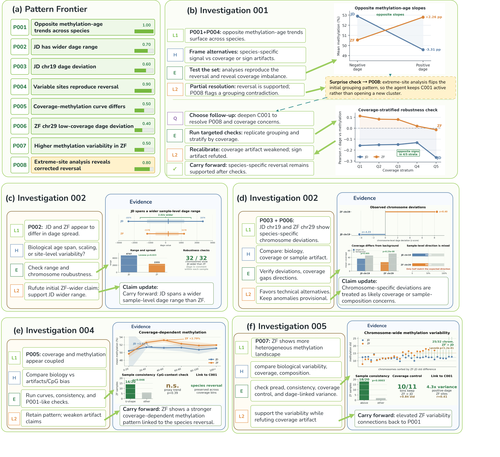

# StatefulDiscovery
[](https://arxiv.org/abs/2606.11851) [](LICENSE)

[English](README.md) | 中文

## Evidence-Calibrated Claim Formation in Open-Ended Scientific Discovery
 StatefulDiscovery 是一个面向开放式科学发现的智能体框架。不同于只执行预定义分析问题的流程，开放式发现要求智能体在多轮探索中持续判断哪些现象值得进一步研究，并避免提出超出当前证据支持范围的结论。为了解决这一问题，StatefulDiscovery 将“发现状态”显式外化，用于协调前沿现象选择、证据获取和论断纠偏，使探索过程和可声明结论保持同步。



## 安装

```bash
git clone https://github.com/Nazzyyj/StatefulDiscovery-Dev.git
cd ./StatefulDiscovery-Dev
```

### 依赖

主机侧依赖：
- Docker
- Git
- Python 3.10+
- GitHub CLI (`gh`)，用于 clone private development repository

支持的宿主平台：
- macOS Apple Silicon (`arm64`)，使用 Docker Desktop
- Ubuntu Linux AMD64 (`x86_64`) 或 ARM64 (`aarch64`)，使用 Docker Engine

其他可运行 Linux 容器的宿主平台也可能兼容，但目前尚未验证。

安装数据下载、任务转换和可选 dashboard 所需的 Python 工具：

```bash
pip install -r requirements.txt
```

## 配置 Backbone 模型 API-KEY

复制配置模板：

```bash
cp config.env.example config.env
```

然后在 `config.env` 中填写运行容器内 agent 使用的模型配置：

```bash
ANTHROPIC_API_KEY=""
ANTHROPIC_BASE_URL="https://dashscope.aliyuncs.com/apps/anthropic"
ANTHROPIC_MODEL="qwen3.5-plus"
```

`config.env` 不会提交到 Git；运行脚本会读取这个文件并将配置传入容器。

## 数据准备+处理
StatefulDiscovery在3个benchmark共40个数据集上进行评估。因为我们的目的是open-ended的发现，需要将benchmark的所有测试问题剔除，让agent接收数据集本身进行开放式探索。我们在 [DiscoveryBench](https://huggingface.co/datasets/allenai/discoverybench), [BLADE](https://github.com/behavioral-data/BLADE)以及[BixBench](https://huggingface.co/datasets/phylobio/BixBench-Verified-50) 进行预处理，以屏蔽特定的查询和问题。

建议先下载处理DiscoveryBench进行测试。且可能需要huggingface镜像`export HF_ENDPOINT=https://hf-mirror.com`
```bash
# DiscoveryBench
hf download allenai/discoverybench --repo-type dataset --include 'discoverybench/real/test/**' --local-dir .
mv ./discoverybench/real/test/* ./discoverybench/
rmdir ./discoverybench/real/test ./discoverybench/real
rm -rf ./.cache
# 转换为open-ended任务，并写入 ./datasets/discoverybench/<task>/
python3 scripts/prepare_discoverybench_tasks.py
rm -rf ./discoverybench
```
``` bash
# BLADE
git clone --depth 1 --filter=blob:none --sparse https://github.com/behavioral-data/BLADE.git ./blade_repo
git -C ./blade_repo sparse-checkout set blade_bench/datasets
mkdir -p ./blade
cp -R ./blade_repo/blade_bench/datasets/* ./blade/
rm -rf ./blade_repo
# 转换为open-ended任务，并写入 ./datasets/blade/<task>/
python3 scripts/prepare_blade_tasks.py
rm -rf ./blade
```
``` bash
# BixBench-v50
mkdir -p ./bixbench/verified50 ./bixbench/full
hf download phylobio/BixBench-Verified-50 --repo-type dataset --local-dir ./bixbench/verified50
hf download futurehouse/BixBench BixBench.jsonl --repo-type dataset --local-dir ./bixbench/full
# 转换为open-ended任务，并写入 ./datasets/bixbench/<task>/
python3 scripts/prepare_bixbench_tasks.py
rm -rf ./bixbench
```

转换后的每个任务目录包含数据文件和 `task_packet.json`：

```text
datasets/xxx/<任务名>/
  数据文件...
  task_packet.json
```

`task_packet.json` 只包含 open-ended 运行需要的信息，包括 `task_id`、
`dataset_paths`、带列说明的 `column_metadata` 和 `budget`。其中 `task_id`
直接使用任务目录名。脚本不会把原始Benchmarks等含有的queries、hypotheses 或答案写入任务目录。

## 基础镜像配置
由于我们是在沙盒（容器）里进行评估。为保证公平及可复现，需先拉取必要的镜像。无论宿主系统是 macOS 还是 Ubuntu，任务都会在 Linux 容器中运行。我们基于 futurehouse/bixbench 的镜像来构建，但由于该开源镜像仅支持 `linux/arm64`，我们对其进行改造以支持 `linux/amd64`。

### ARM64 宿主机（macOS Apple Silicon / Ubuntu ARM64）
如果宿主机是 ARM64 配置：

```bash
docker pull futurehouse/bixbench:aviary-notebook-env
# 如果需要镜像站的话，推荐 https://1ms.run/
# docker pull docker.1ms.run/futurehouse/bixbench:aviary-notebook-env
```

### AMD64 宿主机（Ubuntu AMD64）
如果宿主机是 AMD64 配置：

```bash
# docker pull xxx
# 也可以从 dockerfile 直接构建
docker build --platform linux/amd64 -t futurehouse/bixbench:aviary-notebook-env -f dockerfiles/Dockerfile.bixbench-base.amd64 .
```

## 运行任务（Claude Code）
我们提供不同coding agent的支持，首先是Claude Code CLI，版本固定为 `2.1.76`。
相关文件放在独立路径下：

```text
dockerfiles/Dockerfile.claude
container/claude/CLAUDE.md
claude_skills/
scripts/run_claude_task.sh
```

运行单个任务：

```bash
./scripts/run_claude_task.sh datasets/discoverybench/nls_incarceration discovery_output/discoverybench/nls_incarceration
```

本项目也提供实时跟踪的看板，如果需要启动实时 dashboard:
```bash
./scripts/run_claude_task.sh datasets/discoverybench/nls_incarceration discovery_output/discoverybench/nls_incarceration --dashboard 8050
```


脚本会自动构建 Docker 镜像 `stateful-discovery-claude`，并将任务数据复制到运行目录：
首次构建镜像通常需要 5–10 分钟，其中 Conda 依赖求解阶段可能暂时没有新日志；后续运行通常会复用 Docker 构建缓存。

```text
discovery_output/discoverybench/<任务名>/run_YYYYMMDD_HHMMSS/
```

容器运行时会将该运行目录挂载到 `/workspace/run`。任务数据和 agent 产出的
`patterns.json`、`experiments.jsonl`、`claims.json`、`report.md` 等结果都会写在
这个目录下。

Claude Code 的 `stream-json` 流式日志单独写入：

```text
discovery_log/discoverybench/<任务名>/run_YYYYMMDD_HHMMSS/stream.jsonl
```

## 运行任务（OpenCode）

OpenCode 后端相关文件放在独立路径下：

```text
dockerfiles/Dockerfile.opencode
container/opencode/AGENTS.md
opencode_skills/
opencode_agents/
scripts/run_opencode_task.sh
```

运行方式与 Claude Code 版本一致：

```bash
./scripts/run_opencode_task.sh datasets/discoverybench/nls_incarceration
```

OpenCode 版本会自动构建 Docker 镜像 `stateful-discovery-opencode`。它复用
`config.env` 中的 `ANTHROPIC_API_KEY`、`ANTHROPIC_BASE_URL` 和
`ANTHROPIC_MODEL`，并在运行时生成 OpenCode 配置。运行输出仍写入
`discovery_output/`，JSON 事件日志仍写入 `discovery_log/`。

`dockerfiles/Dockerfile.opencode` 中的 OpenCode CLI 版本固定为 `1.2.26`，
与当前 Claude Code `2.1.76` 的发布时间接近。

OpenCode 版本将 Claude Code 中 `context: fork` 的两个阶段改为 OpenCode
subagent：

```text
opencode_agents/investigation-decomposition.md
opencode_agents/experiment-runner.md
```

其他可复用方法说明保留为 OpenCode skills。

## Experimental Rounds
以Bixbench中的bix-52为例，我们将其流程可视化为下图所示。



## License

This repository is released under the MIT License. Datasets used by the benchmark preparation scripts are subject to their original licenses.

## Citation

如果您觉得本工作有帮助，请引用：

```bibtex
@misc{chen2026statefuldiscoveryevidencecalibratedclaimformation,
      title={StatefulDiscovery: Evidence-Calibrated Claim Formation in Open-Ended Scientific Discovery},
      author={Jiayao Chen and Shi Liu and Linyi Yang},
      year={2026},
      eprint={2606.11851},
      archivePrefix={arXiv},
      primaryClass={cs.AI},
      url={https://arxiv.org/abs/2606.11851},
}
```
